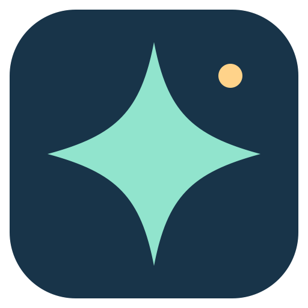
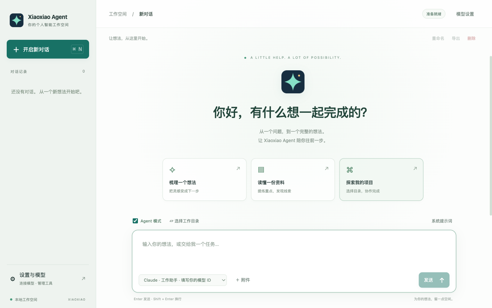

  

<h1 align="center">Xiaoxiao Agent</h1>

<strong>自己的模型，自己的工具，自己的 AI 工作空间。</strong>

多模型桌面 AI Agent · 自定义 API · 流式对话 · 工作目录工具 · MCP

  
  
  
  

  <a href="#快速开始">快速开始</a> ·
  <a href="#模型接入">模型接入</a> ·
  <a href="#agent-与工具">Agent 与工具</a> ·
  <a href="docs/usage.md">完整使用指南</a>

---

Xiaoxiao Agent 是一个独立开发的 AI 桌面客户端。你可以连接自己的模型 API，在同一个工作空间内对话、阅读资料、处理项目文件，并通过 MCP 扩展工具。

应用使用独立名称、图标、应用标识和本地数据目录。无需安装 Claude 桌面端，也不读取它的账户、配置或聊天记录。

> 界面截图使用演示配置，不包含个人数据或真实 API Key。当前为 v0.2.0 试用版，已验证 macOS Apple Silicon；模型的工具能力取决于提供商与具体模型。

## 能做什么

| 能力 | 当前实现 |
| --- | --- |
| **连接多个模型** | Anthropic、OpenAI Compatible、Ollama；内置常见服务地址预设 |
| **自定义 API** | 配置 Base URL、API Key、模型 ID，支持测试连接与获取模型列表 |
| **流式对话** | 增量回复、Markdown 展示、多轮上下文和停止生成 |
| **本地会话** | 自动保存、重启恢复、重命名、删除和 Markdown 导出 |
| **工作目录 Agent** | 列目录、读文件、经确认写文件与运行命令 |
| **资料与网页** | UTF-8 文本附件、公共 HTTPS 网页文本读取 |
| **MCP 扩展** | stdio 与 Streamable HTTP，自动发现工具 |
| **品牌定制** | 自有应用名称、图标、安装包标识与界面 |
| **密钥保护** | API Key 与 MCP env/header 值经系统加密保存 |

## 快速开始

### 从源码启动

需要 **Node.js 22.16+** 和 npm。

~~~bash
git clone https://github.com/Shamnick/Xiaoxiao-Agent.git
cd Xiaoxiao-Agent
npm ci
npm start
~~~

Electron 首次安装需要下载运行时。下载受限或 npm 禁用了安装脚本时，参阅[安装说明](docs/usage.md#开发运行)。

### 第一次使用

1. 打开「模型设置」，选择服务预设或自定义接口。
2. 填写你实际可用的模型 ID、Base URL 和 API Key。
3. 保存配置，可使用「测试连接」检查服务。
4. 回到工作区，选择模型并发送消息。
5. 若要处理本地项目，开启 **Agent 模式**，再选择工作目录。

API 用量由你配置的提供商计费；无需 API Key 的本地服务可以留空。

## 模型接入

| 提供商或部署 | 接口类型 | 使用方式 |
| --- | --- | --- |
| Anthropic / Claude API | Anthropic | 原生 Messages 接口 |
| OpenAI | OpenAI Compatible | Chat Completions 接口 |
| DeepSeek | OpenAI Compatible | 从预设填充，或配置自己的网关 |
| Gemini | OpenAI Compatible | 使用 Google 的 OpenAI 兼容入口 |
| 通义千问 | OpenAI Compatible | 使用 DashScope 兼容入口 |
| Ollama | Ollama | 本地默认地址，无需密钥 |
| 自建网关 / 其他模型 | OpenAI Compatible | 自定义 Base URL 与模型 ID |

Base URL 填服务根地址，不附加 messages 或 chat/completions。不同网关的功能可能不同；不支持流式传输时可关闭该选项，Agent 模式需要模型支持工具调用。

查看模型设置界面

## Agent 与工具

Agent 会根据任务调用工具，将结果传回模型，再继续下一步。默认最多 12 轮，可在设置中调整为 1–30 轮，也可随时停止。

| 内置工具 | 用途 |
| --- | --- |
| list_files | 浏览所选目录 |
| read_file | 读取目录内文本 |
| write_file | 写入文本，先预览并确认 |
| run_command | 运行命令，先展示命令并确认 |
| read_selected_document | 读取本次附加的文本资料 |
| fetch_url | 读取公共 HTTPS 网页文本 |

文件工具限制在选定工作目录内，并检查规范路径与符号链接。命令以当前用户权限运行，**工作目录不是操作系统沙箱**；确认窗口会展示命令、目录和执行时限。

### 用 MCP 扩展

进入「设置与模型 → MCP 与运行」，填写服务数组。示例为默认关闭的浏览器 MCP：

~~~json
[
  {
    "name": "Browser",
    "transport": "stdio",
    "command": "npx",
    "args": ["-y", "@playwright/mcp@latest"],
    "env": {},
    "enabled": false
  }
]
~~~

设为 enabled: true 后，下次 Agent 请求会提示连接；每次工具调用也需要确认。远程 MCP 使用 transport: "http"、url 和 headers。

浏览器操作由外部 MCP 服务提供，需要安装其依赖。推荐在正式使用时固定服务器版本。更多参数与限制见[完整指南](docs/usage.md#浏览器与其他-mcp)。

## 独立应用与数据

| 项目 | Xiaoxiao Agent |
| --- | --- |
| 应用名称 | Xiaoxiao Agent |
| 应用标识 | com.xiaoxiao.agent |
| macOS 应用 | /Applications/Xiaoxiao Agent.app |
| 本地数据 | ~/Library/Application Support/Xiaoxiao Agent |
| 配置与会话 | providers.json、settings.json、conversations.json |
| 账户来源 | 由用户配置的模型 API |

不会导入或覆盖 Claude 的应用、配置、会话及凭据。同一对话中切换模型，会把该对话的有效历史发送给新选模型；需要隔离不同提供商时，请新建对话。

密钥使用系统加密存储；聊天记录与项目文件本身不加密。附加的文本和工具结果，会在调用时发送给当前选择的模型服务。

## 开发与构建

~~~bash
npm run check          # JavaScript 语法检查
npm test               # 模型、流式响应、工具、MCP 和存储测试
npm run test:desktop   # Electron 桌面集成测试
npm run icons          # 从 SVG 生成 macOS 安装包图标
npm run pack           # 生成 .app
npm run dist:mac       # 生成 arm64 DMG
~~~

桌面测试使用临时数据目录和本地模拟 API，不需要付费 API Key。已验证流式工具循环、历史保存、重启恢复、停止任务、Markdown、重命名与导出；MCP 测试包含真实 stdio 握手和进程清理。

当前构建未使用 Apple Developer ID 签名或公证，适合本地试用。Windows/Linux 打包目标尚未验证。

### 项目结构

~~~text
src/
  main.js           Electron 主进程与受控 IPC
  preload.js        桌面能力桥接
  renderer.js       对话、配置与运行状态
  providers.js      模型适配、流式解析和 Agent 循环
  tools.js          工作目录文件与命令工具
  mcp.js            MCP 连接、工具发现与调用
  web.js            公共网页文本读取
  store.js          本地原子存储
  brand.json        应用名称与图标配置
test/               单元与集成测试
scripts/            图标生成、截图与桌面测试
docs/               使用指南与界面预览
electron-builder.yml
~~~

更换品牌时，同步修改 src/brand.json、图标、package.json 和 electron-builder.yml 中的安装包元数据。

## 当前范围

这是独立实现的多模型 Agent，目标是提供可扩展的个人工作空间。当前不包含其他产品的专有服务、订阅权益或系统级电脑控制，也未接入云同步、自动更新、图片/PDF 输入和长期记忆。真实提供商兼容性需要使用你自己的 API 配置验证。

项目暂未指定开源许可证；第三方依赖遵循各自许可证。

## 反馈

欢迎通过 [Issues](https://github.com/Shamnick/Xiaoxiao-Agent/issues) 提交问题与功能建议。请附上系统版本、应用版本、接口类型及复现步骤，并移除 API Key、会话隐私和服务凭据。
