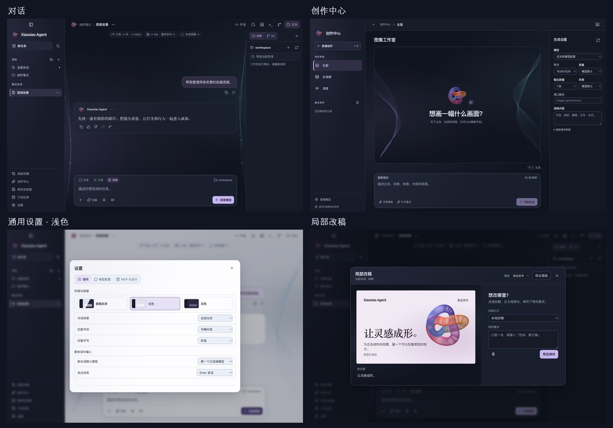
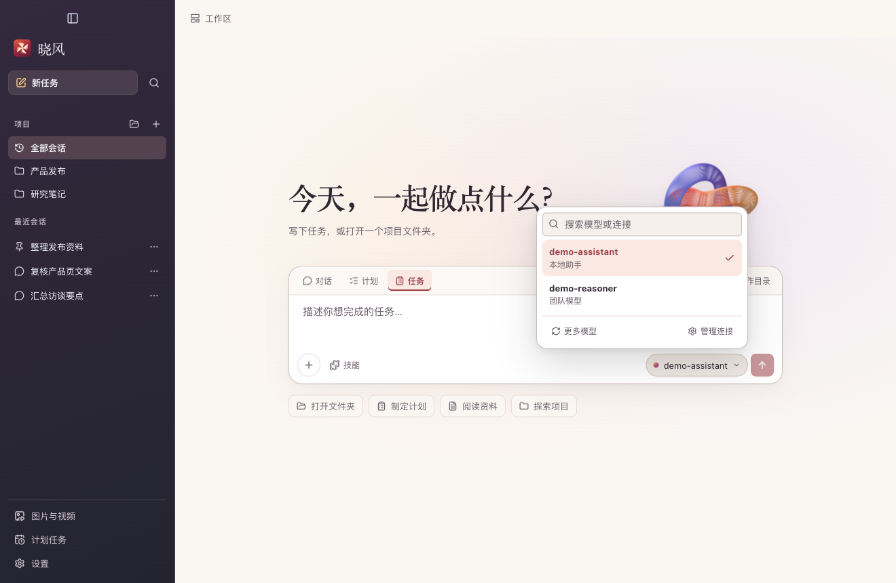
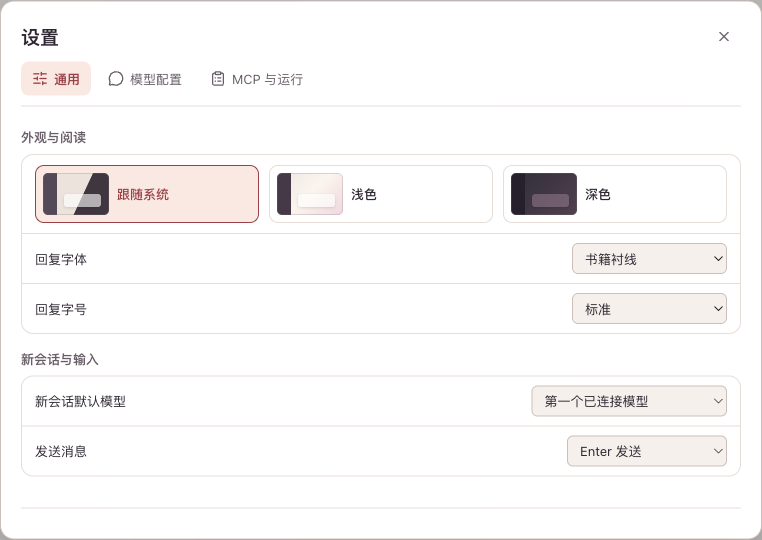
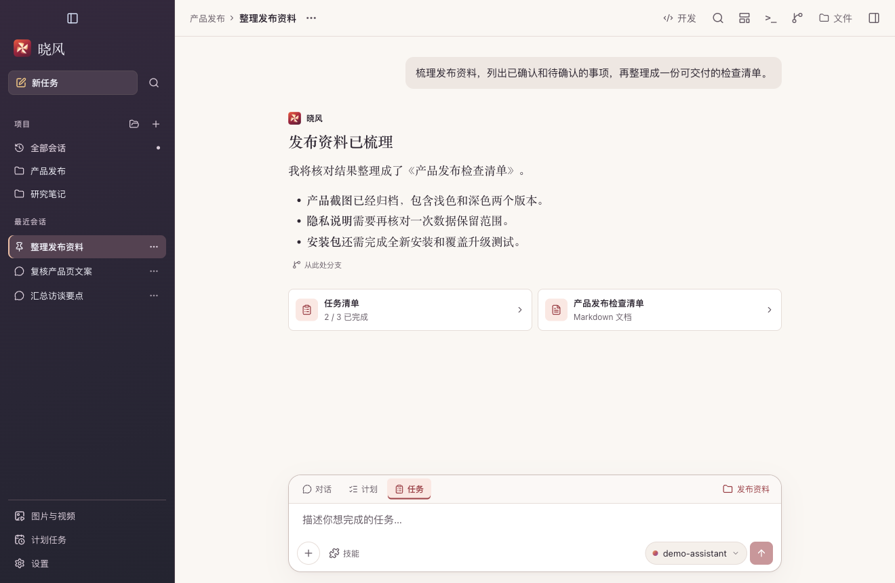
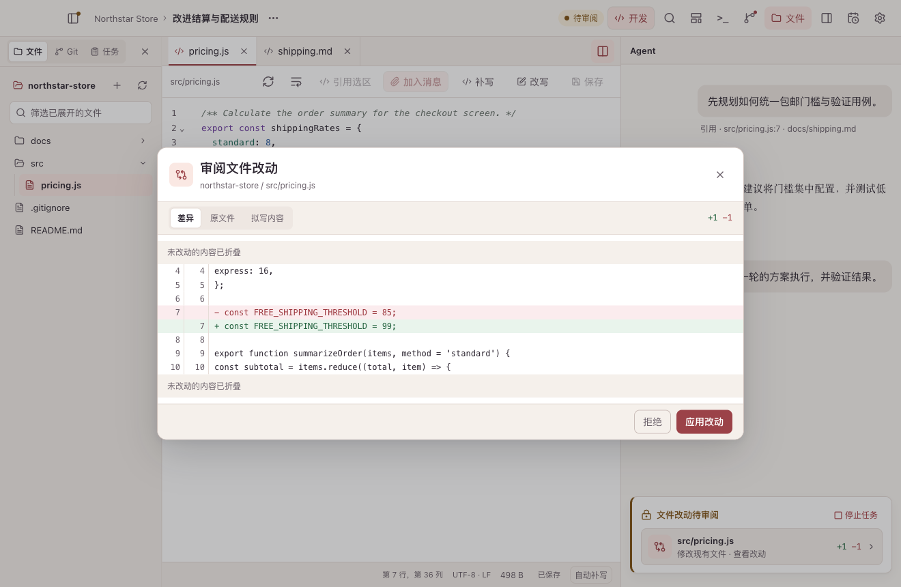
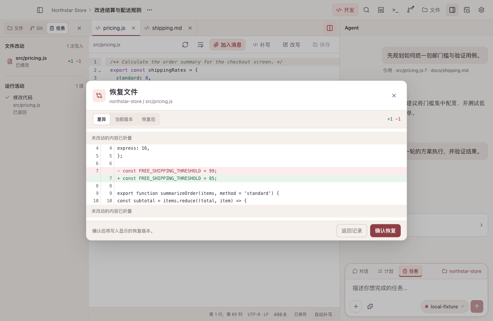
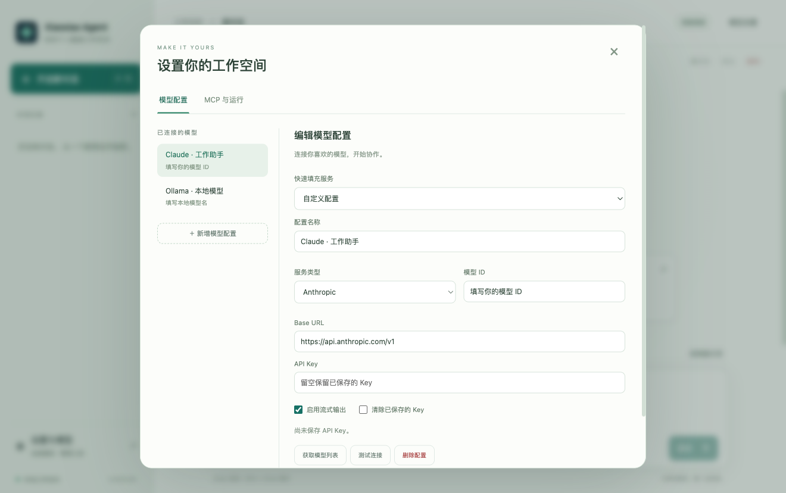

  

<h1 align="center">Xiaoxiao Agent</h1>

连接自己的模型 API，在桌面上理解素材、编辑项目、审查代码并运行 Agent 任务。

  
  
  
  

  <a href="#快速开始">快速开始</a> ·
  <a href="#模型接入">模型接入</a> ·
  <a href="#agent-与工具">Agent 与工具</a> ·
  <a href="docs/usage.md">完整使用指南</a> ·
  <a href="docs/workflow-coverage.md">工作流对照</a> ·
  <a href="docs/innovation-roadmap.md">六期计划与验收进度</a>

---

Xiaoxiao Agent 是一个独立开发的多模型桌面工作空间。打开本地项目后，可以在同一窗口测试图片和视频画面、搜索和编辑代码，用 Agent 制定计划、处理差异，再通过 Git 审阅并提交。

应用使用独立名称、图标、应用标识、模型配置和本机数据目录。

> 界面截图使用演示数据。0.6.16 已在 Apple Silicon Mac 验证源码运行。正式安装仍待签名和公证。任务工具需要模型支持工具调用，视觉实验室需要支持图像输入的模型。

点开首页丝结，进入「试试局部改稿」。可以只改海报标题，比较后采纳，预览并导出 PNG 海报，再把满意的一句送到语音工作室。在 Mac 上选择系统语音即可导出 WAV。已取得任务号的视频，重启后也能从历史继续查询。生图会话里可导入参考图，也可选中历史图片继续修改，在同一画布比较并导出原图。[分期进度](docs/innovation-roadmap.md)

查看对话和任务界面

## 能做什么

| 能力 | 当前实现 |
| --- | --- |
| **macOS 界面** | 可交互的丝结首页，主进程 CPU 与内存实时读数，听写和文本共用输入框。工作区支持浅色、深色和跟随系统 |
| **连接多个模型** | Anthropic、OpenAI Compatible、Ollama；内置常见服务地址预设 |
| **自定义 API** | 配置 Base URL、API Key、模型 ID，支持测试连接与获取模型列表。普通对话可直接检测兼容接口并保存 HTML 报告 |
| **流式对话** | 增量回复、Markdown 展示、多轮上下文和停止生成 |
| **并行任务** | 最多同时运行三个会话，可逐个停止、补充或确认。单个任务也可并行分析最多三份独立资料，再汇总结果 |
| **本地会话** | 各会话分别恢复未发送草稿、按回复创建独立分支、重命名、置顶、删除和 Markdown 导出 |
| **开发工作台** | 打开项目后按 `⌘2` 进入三栏工作台。支持在项目内新建文件、跨标签撤销、语法提示、保存冲突检查、项目 PTY 终端和本机网页预览 |
| **AI 编辑** | 在光标处补写、按项目启用随键入补写、以自然语言改写选区。采纳建议后由你保存 |
| **搜索与引用** | 搜索项目文件和内容并跳到匹配行。用 `@` 或编辑器选区加入消息 |
| **Git** | 新建和切换本地分支，逐文件审阅、暂存和取消暂存，使用 Agent 只读审查单文件或暂存区内的多文件差异，按快照提交 |
| **计划模式** | 只读检查项目并总结实施步骤。使用「按计划执行」进入任务模式继续 |
| **文件改动** | 逐项审批写入，每个会话可查阅最近 40 次写入记录。文件仍与当时写入版本一致时，可审阅差异并恢复原文 |
| **项目资料** | 保存 UTF-8 文本快照，供同一项目内的对话和任务复用 |
| **交付物** | 每个会话保存多份 Markdown 文档，预览并逐份导出为 Markdown、PDF 或可编辑的 Word |
| **技能** | 内置工作流程，支持预览、导入与编辑自定义 `SKILL.md` 文本 |
| **计划任务** | 应用运行时按每天或每周执行只读任务，结果归档到新会话 |
| **附件与网页** | 每条消息最多引用四份文本资料，任务可读取公共 HTTPS 网页 |
| **视觉实验室** | 直接测试 PNG、JPG、WebP 与 MP4、MOV、WebM。视频均匀抽取 6 帧并交给视觉模型，不包含音频 |
| **创作中心** | 从独立工作区生成图片、视频和语音，选择已配置模型，预览结果并保存文件。生图支持同会话内跨轮对比。兼容 OpenAI 风格接口，可按服务自定义 endpoint |
| **MCP 扩展** | stdio 与 Streamable HTTP，自动发现工具 |
| **品牌定制** | 自有应用名称、图标、安装包标识与界面 |
| **密钥保护** | API Key 与 MCP env/header 值经系统加密保存 |

## 快速开始

### 从源码启动

需要 **Node.js 22.16+** 和 npm。

~~~bash
git clone https://github.com/Shamnick/Xiaoxiao-Agent.git
cd Xiaoxiao-Agent
npm ci
npm start
~~~

Electron 首次安装需要下载运行时。下载受限或 npm 禁用了安装脚本时，参阅[安装说明](docs/usage.md#开发运行)。

### 第一次使用

1. 点击首页丝结展开输入框，再点「连接模型」。也可以用左上角的分栏按钮展开导航，从「设置」添加服务。
2. 填写你实际可用的模型 ID、Base URL 和 API Key。
3. 保存配置，可使用「测试连接」检查服务。
4. 回到工作区，选择模型并发送消息。
5. 点击「打开文件夹」选择项目。按 `⌘P` 搜索文件，打开文件后可点右侧的「并排显示 Agent」。先用「计划」检查范围，再用「任务」执行。

API 用量由你配置的提供商计费；无需 API Key 的本地服务可以留空。

## 模型接入

| 提供商或部署 | 接口类型 | 使用方式 |
| --- | --- | --- |
| Anthropic / Claude API | Anthropic | 原生 Messages 接口 |
| OpenAI | OpenAI Compatible | Chat Completions 接口 |
| DeepSeek | OpenAI Compatible | 从预设填充，或配置自己的网关 |
| Gemini | OpenAI Compatible | 使用 Google 的 OpenAI 兼容入口 |
| 通义千问 | OpenAI Compatible | 使用 DashScope 兼容入口 |
| Ollama | Ollama | 本地默认地址，无需密钥 |
| 自建网关 / 其他模型 | OpenAI Compatible | 自定义 Base URL 与模型 ID |

Base URL 填服务根地址，不附加 messages 或 chat/completions。不同网关的功能可能不同；不支持流式传输时可关闭该选项，Agent 模式需要模型支持工具调用。

查看模型设置界面

## Agent 与工具

Agent 会根据任务调用工具，将结果传回模型，再继续下一步。默认最多 12 轮，可在设置中调整为 1–30 轮，也可随时停止。

在侧栏的「正在进行」返回任一任务。使用「补充」把要求加入下一次模型请求。提问、文件改动、命令和连接器审批会出现在当前任务输入区。任务详情集中显示清单、运行活动、交付物和写入记录。

| 内置工具 | 用途 |
| --- | --- |
| list_files | 浏览所选目录 |
| read_file | 读取目录内文本 |
| search_workspace | 搜索工作区文件及内容 |
| edit_file | 对既有文本做精确替换，每次写入前审阅差异 |
| write_file | 审阅原文、拟写版本和逐行差异，确认后写入文本 |
| run_command | 运行命令，先展示命令并确认 |
| read_selected_document | 读取本次附加的文本资料 |
| fetch_url | 读取公共 HTTPS 网页文本 |

文件工具限制在选定工作目录内，并检查规范路径与符号链接。命令以当前用户权限运行，**工作目录不是操作系统沙箱**；确认窗口会展示命令、目录和执行时限。

### 用 MCP 扩展

进入「设置 → MCP 与运行」，填写服务数组。示例为默认关闭的浏览器 MCP：

~~~json
[
  {
    "name": "Browser",
    "transport": "stdio",
    "command": "npx",
    "args": ["-y", "@playwright/mcp@latest"],
    "env": {},
    "enabled": false
  }
]
~~~

设为 enabled: true 后，下次 Agent 请求会提示连接；每次工具调用也需要确认。远程 MCP 使用 transport: "http"、url 和 headers。

浏览器操作由外部 MCP 服务提供，需要安装其依赖。推荐在正式使用时固定服务器版本。更多参数与限制见[完整指南](docs/usage.md#浏览器与其他-mcp)。

## 独立应用与数据

| 项目 | Xiaoxiao Agent |
| --- | --- |
| 应用名称 | Xiaoxiao Agent |
| 应用标识 | com.xiaoxiao.agent |
| macOS 应用 | /Applications/Xiaoxiao Agent.app |
| 本地数据 | ~/Library/Application Support/Xiaoxiao Agent |
| 配置与会话 | `providers.json`、`settings.json`、`conversations.json`、`projects.json`、`skills.json`、`schedules.json` |
| 账户来源 | 由用户配置的模型 API |

同一对话中切换模型，会把该对话的有效历史发送给新选模型。需要隔离不同提供商时，请新建对话。

密钥使用系统加密存储。聊天记录、项目资料快照和写入前后的文本以明文保存在本机。模型调用读取工具时，资料正文会作为工具结果发送给当前选择的模型服务。编辑器补写和改写会发送所选片段及相邻代码。每个工作区首次开启自动补写前，编辑器只在明确请求时发送代码建议。

## 开发与构建

~~~bash
npm run check          # JavaScript 语法检查
npm test               # 模型、流式响应、工具、MCP 和存储测试
npm run test:desktop   # Electron 桌面集成测试
npm run icons          # 刷新 Lucide 图标；在 macOS 生成应用 PNG 与 ICNS
npm run screenshots    # 使用隔离演示数据生成 README 与外观检查截图
npm run pack           # 生成 .app
npm run dist:mac       # 生成 arm64 DMG
~~~

桌面测试在隔离的临时数据目录运行，使用本地模拟模型 API。回归覆盖代码建议与撤销、审批写入和恢复、Git 分支与暂存审查、本机网页预览、真实 PTY 终端、会话恢复、技能导入和文档导出。MCP 测试包含实际 stdio 握手和进程清理。

本地 arm64 构建使用临时签名。正式分发可用 `npm run release:mac -- --check` 检查发布机配置，用 `npm run release:mac` 签名、提交 Apple 公证并从最终 DMG 运行桌面回归。[Mac 发布说明](docs/usage.md#正式分发-mac-安装包)

### 项目结构

~~~text
src/
  main.js           Electron 主进程与受控 IPC
  preload.js        桌面能力桥接
  renderer.js       对话、配置与运行状态
  providers.js      模型适配、流式解析和 Agent 循环
  schedules.js      本地计划任务、运行状态与恢复
  skills.js         技能元数据、导入和任务选用
  task-plan.js      清单与交付物工具
  workspace-files.js    工作目录浏览与文本快照
  workspace-search.js   项目文件和内容搜索
  workspace-git.js      差异、暂存区、本地分支与提交
  workspace-preview.js  独立本机网页预览窗口
  workspace-review.js   逐行差异与写入前检查
  code-assist.js        有限上下文的代码建议
  editor-entry.mjs      CodeMirror 编辑工作区
  terminal.js           项目 PTY 生命周期
  tools.js          工作目录文件与命令工具
  mcp.js            MCP 连接、工具发现与调用
  web.js            公共网页文本读取
  store.js          本地原子存储
  brand.json        应用名称与图标配置
test/               单元与集成测试
scripts/            图标生成、截图与桌面测试
docs/               使用指南与界面预览
electron-builder.yml
~~~

更换品牌时，同步修改 src/brand.json、图标、package.json 和 electron-builder.yml 中的安装包元数据。

## 当前范围

当前面向 macOS 本地试用。真实模型的工具调用和代码建议需要按服务验证。

[查看 TRAE 工作流对照](docs/workflow-coverage.md)

项目暂未指定开源许可证；第三方依赖遵循各自许可证。界面线性图标使用 [Lucide](src/icons/lucide/LICENSE)。

## 反馈

欢迎通过 [Issues](https://github.com/Shamnick/Xiaoxiao-Agent/issues) 提交问题与功能建议。请附上系统版本、应用版本、接口类型及复现步骤，并移除 API Key、会话隐私和服务凭据。
